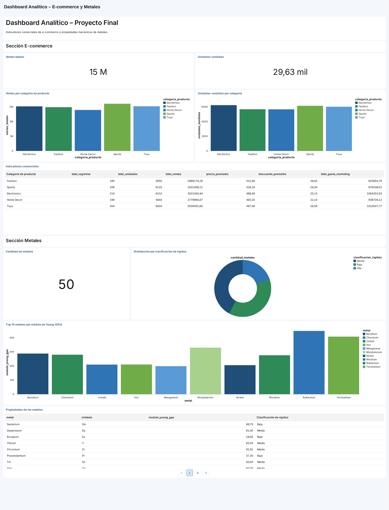

# Dashboard Analítico

Esta carpeta contiene las evidencias y el enlace
del Dashboard desarrollado en Azure Databricks.

Dashboard: E-commerce y Metales

Indicadores:
- Ventas totales
- Unidades vendidas
- Ventas por categoría
- Clasificación de rigidez de metales
- Módulo de Young

## Evidencia

[Ver PDF completo](./Dashboard_Analítico_E_commerce_Metales.pdf)
